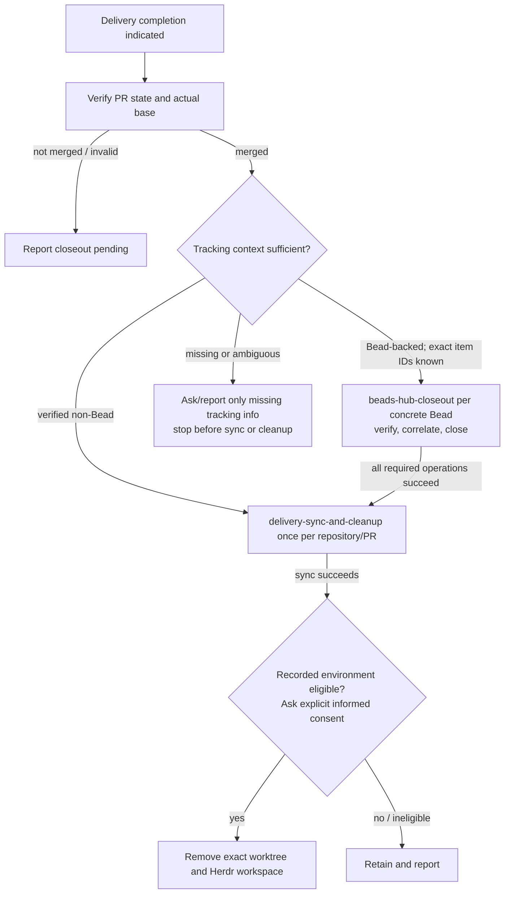

# Delivery Closeout Router

Use automatically when conversation or runtime context indicates the requested
delivery endpoint is complete; ordinary reports such as “done” or “completed”
suffice, and the user need not explicitly say “PR merged” or select a skill or
mode. If the context is merge-bound, verify the PR before any such operation and
never merge automatically. Require its full URL:

```sh
gh pr view <full-pr-url> --json state,mergedAt,mergeCommit,baseRefName
```

Require merged state, non-empty merge time, a valid 40-hex merge SHA, and a
valid actual base branch. If the PR is open, closed-but-unmerged, the URL is
missing, or verification fails, report **closeout pending** (or the exact
verification failure) and do not correlate, synchronize, or offer cleanup.
Record the verified PR URL, repository, merge SHA, and base for this run.



Use existing orchestration context to establish whether tracking is Bead-backed
or verified non-Bead; absence of a Bead ID alone does not prove non-Bead work.
If classification is missing or ambiguous, ask only whether this delivery is
Bead-backed and stop before synchronization or cleanup. If it is Bead-backed but
exact item IDs (or known relevant child IDs for a shared PR) are missing, ask
only for those IDs and stop. When context is sufficient, route automatically
without a routine mode question.

## Bead operations

For a single concrete Bead, use the existing `beads-hub-closeout` operation
with exactly its two established inputs: the exact private item ID and full PR
URL. From that repository's registered context, run:

```sh
skills/beads-hub-closeout/closeout.sh <private-work-item-id> <full-pr-url>
```

It owns Bead verification, merge correlation, and closure; do not supply a mode
or add reference synchronization, disposal, or questionnaire behavior to that
operation. A failed operation is reported as a Bead-phase failure and blocks
later phases for that PR.

For an epic PR shared by multiple concrete children, use only the known relevant
child IDs already recorded by orchestration. Run the same operation once for
each child not already recorded as successfully closed. Do not invoke concrete
closeout against the epic or discover/infer children. Report per-child results;
only proceed when every required child operation succeeded or has recorded
successful evidence. For an epic, do not invoke the concrete-item script against
the epic itself. Keep epic-level links and closure in the existing epic closeout
flow; this adds no epic-link-before-sync prerequisite. Do not discover children
or infer SHAs. Proceed to synchronization after the required known concrete-child
operations succeed.

## Shared repository/PR closeout

After all required Bead operations succeed (or immediately for non-Bead work),
run `delivery-sync-and-cleanup` once for this repository and PR, passing the
verified merge details and only runtime-recorded reference checkout and delivery
environments. A shared epic PR still gets one synchronization, not one per
child. Reuse a recorded successful synchronization for the same repository/PR;
never repeat a successful pull. The shared skill owns synchronization and
consent-based environment cleanup.

Report Bead, synchronization, and each cleanup outcome distinctly. A Bead
failure blocks synchronization; a synchronization failure blocks cleanup. Do
not retry or undo completed phases, force removal, guess missing identities, or
claim a later phase succeeded when it did not. Before merge or at any pre-merge
delivery endpoint, report closeout as pending.