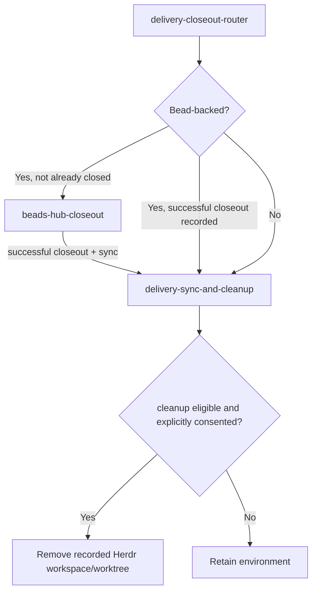

# Delivery Closeout Router

Use only after implementation and review are complete and the user has reached
the requested delivery endpoint. Never merge automatically. Load
`delivery-sync-and-cleanup` for every path.

A successful Hub closeout includes synchronization; never repeat it. Shared-handoff
mode is used only through this router, while standalone `beads-hub-closeout`
retains its own disposal questionnaire. Cleanup in the shared procedure always
requires the user's explicit consent.

- **Bead-backed:** if this concrete item's successful Bead closeout is already
  recorded in the current orchestration state, retain its evidence and go
  directly to the shared skill with reference synchronization marked complete;
  do not rerun Hub closeout or pull. Otherwise, run `beads-hub-closeout` in
  **shared-handoff mode**. It owns verification, correlation, closure, and
  reference synchronization. On success, it returns without its standalone
  disposal questionnaire, and this entry point continues to the shared skill,
  which owns the single combined cleanup consent. On failure or partial success,
  stop and report it; do not retry synchronization or clean up. Never answer a
  disposal question on the user's behalf or treat a decline as consent.
- **Non-Bead:** use the shared skill directly; no Hub command or Bead dependency
  is needed.

Pass only runtime-recorded checkout, branch, worktree path, and Herdr workspace
identities. Never persist private Bead IDs or `ctx:` identities in files or Git
metadata, and do not invent or discover a substitute cleanup target. The user
must inspect and explicitly approve this skill composition before it is treated
as accepted; do not claim that approval on the user's behalf.
